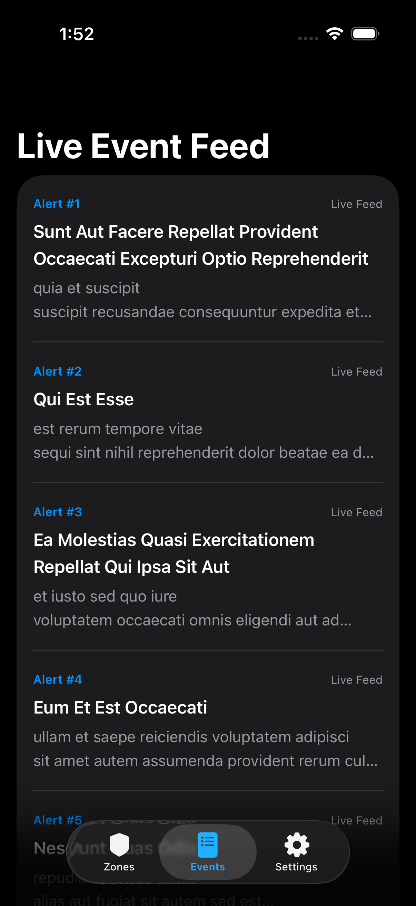
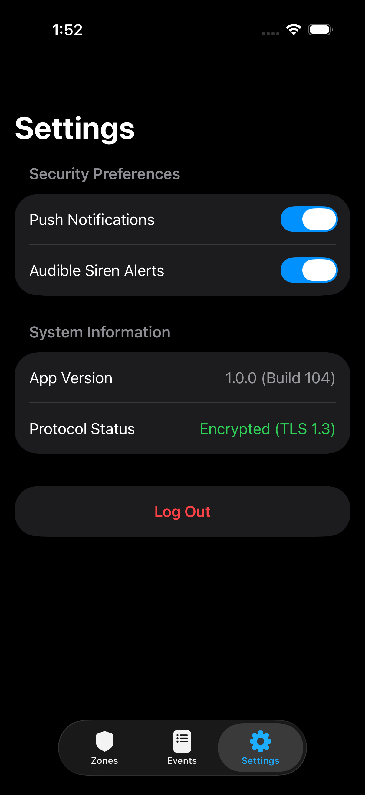

# 🛡️ Security Monitoring Companion

An enterprise-grade, multi-screen **iOS security monitoring application** built with **SwiftUI**, **SwiftData**, and modern **Swift Concurrency (`async/await`)**. Developed as a capstone sandbox project to demonstrate robust local persistence, asynchronous networking, clean architectural patterns, and automated unit testing.

> **Platform:** iOS (SwiftUI) · **Language:** Swift · **Persistence:** SwiftData · **Concurrency:** `async/await` + `actor` · **Testing:** XCTest

---

## 📑 Table of Contents

1. [Overview](#-overview)
2. [Key Features](#-key-features)
3. [Screenshots](#-screenshots)
4. [Architecture](#-architecture)
5. [Project Directory Structure](#-project-directory-structure)
6. [Module & File Reference](#-module--file-reference)
7. [Data Models](#-data-models)
8. [Networking Contract](#-networking-contract)
9. [Testing](#-testing)
10. [Execution / Running the Project](#-execution--running-the-project)
11. [Requirements](#-requirements)
12. [Troubleshooting](#-troubleshooting)
13. [Future Improvements](#-future-improvements)
14. [License](#-license)

---

## 🔍 Overview

Security Companion is a local-first security monitoring app. On first launch it seeds a SwiftData store with a set of default security zones. Users authenticate through a mock login screen, then manage zones (arm/disarm, simulate sensor triggers), browse a live event feed fetched from a public API, and configure notification/siren preferences. All zone state is persisted locally via SwiftData and survives app restarts.

---

## 🚀 Key Features

- **Authentication Flow:** Mock login screen managing root application state (any non-empty username/password).
- **Security Zone Dashboard:** Real-time monitoring of designated zones — armed/disarmed status, sensor conditions, battery health.
- **Interactive Zone Details:** Granular metrics inspection with interactive toggles for arming/disarming zones and simulating security breaches.
- **Live Event Feed:** Asynchronous fetching of live security alerts/logs using a mock public API (`async/await` + `actor`), with loading, error, retry, and pull-to-refresh states.
- **Settings & Preferences:** Configurable notification toggles, audible siren preferences, app/system info, and session termination (logout) with confirmation.
- **Automated Unit Testing:** Dedicated `XCTest` suite validating zone state mutation, arm/disarm logic, and trigger safety rules.
- **Offline Resilience:** Zone data persists in a local SwiftData store; seeding guarantees out-of-the-box readiness.

---

## 📸 Screenshots

### Security Zone List
| Zones Overview (1) | Zones Overview (2) |
|---|---|
|  |  |

### Security Zone Details
| Zone Details (1) | Zone Details (2) |
|---|---|
|  |  |

### Live Event Feed


### Settings
| Settings (1) | Settings (2) |
|---|---|
|  |  |

---

## 🏗️ Architecture

The project follows the **MVVM (Model-View-ViewModel)** architectural pattern, leveraging modern Apple frameworks to ensure high maintainability, thread safety, and offline resilience. Business logic is currently colocated in models and views; `SecurityViewModel.swift` is intentionally kept as an extension point for future refactor.

### 1. MVVM Pattern

- **Model:** SwiftData `@Model` classes (`SecurityZone`, `SecurityEvent`) plus the `APIEventDTO` networking DTO. Models own state and simple mutations.
- **View:** SwiftUI views (`LoginView`, `ZoneListView`, `ZoneDetailView`, `EventFeedView`, `SettingsView`, `MainTabView`, `ContentView`). Views are declarative and bind to models/state.
- **ViewModel:** `SecurityViewModel.swift` is reserved for consolidating business logic; currently views interact with SwiftData directly via `@Query`/`@Bindable` and `@Environment(\.modelContext)`.

```
┌─────────────┐     @Binding / @State      ┌──────────────┐
│   View      │ ◄────────────────────────► │   State      │
│  (SwiftUI)  │                            │  (@State,    │
└──────┬──────┘                            │ @AppStorage) │
       │ @Query / @Bindable                └──────────────┘
       ▼
┌─────────────┐     ModelContext            ┌──────────────┐
│  SwiftData  │ ◄────────────────────────► │  Local Store │
│   @Model    │                            │  (on disk)   │
└──────┬──────┘                            └──────────────┘
       │ async/await
       ▼
┌─────────────┐     URLSession             ┌──────────────┐
│ NetworkMgr  │ ◄────────────────────────► │  Remote API  │
│  (actor)    │                            │ (JSONPlace..)│
└─────────────┘                            └──────────────┘
```

### 2. Data Persistence Layer (SwiftData)

- Utilizes native **SwiftData** (`@Model`, `@Query`, `@Bindable`) for zero-overhead local data persistence.
- Schema declares `SecurityZone.self` and `SecurityEvent.self`.
- `ModelConfiguration` uses on-disk storage (`isStoredInMemoryOnly: false`).
- Automated database seeding on first launch via the container configuration block (4 default zones) ensures immediate out-of-the-box readiness.
- `ZoneListView` additionally seeds default zones if the store is empty (defensive fallback).
- Mutations via `@Bindable` (e.g., `zone.isArmed` toggle) and direct property assignment (`zone.sensorStatus = ...`) are persisted through the bound `ModelContext`.

### 3. Networking Layer (Swift Concurrency)

- Encapsulated inside a thread-safe singleton **`actor`** (`NetworkManager.shared`).
- Employs structured concurrency (`async/await`) with `URLSession` to fetch external DTOs safely without blocking the main thread.
- Endpoint: `https://jsonplaceholder.typicode.com/posts?_limit=10` (mock), decoded into `[APIEventDTO]`.
- Typed errors via `NetworkError` (`invalidURL`, `invalidResponse`, `decodingFailed`).

### 4. UI & Navigation Layer (SwiftUI)

- Built entirely with declarative SwiftUI components.
- `NavigationStack` for deep hierarchy routing (Zone list → Zone detail).
- Root-level state binding (`isAuthenticated`) handles seamless transitions between authentication and dashboard views.
- `TabView` with three tabs: **Zones**, **Events**, **Settings**.
- Reactive UI: loading spinners, error states with retry, pull-to-refresh, confirmation dialogs.

### 5. State & Data Flow

| State Kind | Mechanism | Used For |
|---|---|---|
| Transient view state | `@State` | `events`, `isLoading`, `errorMessage`, form fields |
| Shared app state | `@Binding` | `isAuthenticated` passed from `ContentView` |
| Persisted preferences | `@AppStorage` | `pushNotificationsEnabled`, `sirenAlertSound` |
| Persisted domain data | `@Query` / `@Bindable` + `ModelContext` | `SecurityZone` list and detail |
| Network singleton | `actor` | `NetworkManager.shared` |

---

## 📂 Project Directory Structure

```text
SecurityCompanion/
├── App/
│   └── SecurityCompanionApp.swift       # Entry point & SwiftData container setup
├── Models/
│   ├── SecurityZone.swift               # SwiftData persistent zone model
│   └── SecurityEvent.swift              # SwiftData persistent event model
├── Services/
│   └── NetworkManager.swift             # Actor-based async networking service
├── ViewModels/
│   └── SecurityViewModel.swift           # (Extension point; currently empty)
├── Views/
│   ├── Auth/
│   │   └── LoginView.swift              # Mock login authentication screen
│   ├── Dashboard/
│   │   ├── MainTabView.swift            # Core bottom tab navigation container
│   │   └── ZoneListView.swift           # Zone overview list with live status badges
│   ├── Details/
│   │   └── ZoneDetailView.swift         # Detailed diagnostics & arm/disarm toggle
│   ├── Events/
│   │   └── EventFeedView.swift          # Live event feed with pull-to-refresh
│   └── Settings/
│       └── SettingsView.swift           # App preferences & secure logout
├── ContentView.swift                    # Root auth gate
└── SecurityCompanionTests/
    └── SecurityAppTests.swift           # XCTest suite for business logic
```

---

## 📄 Module & File Reference

| File | Responsibility |
|---|---|
| `SecurityCompanionApp.swift` | `@main` entry; builds `ModelContainer`, seeds default zones, injects container into SwiftUI environment. |
| `Models/SecurityZone.swift` | Persistent zone: name, armed state, battery level, sensor status, icon name. |
| `Models/SecurityEvent.swift` | Persistent event: timestamp, message, severity. |
| `Services/NetworkManager.swift` | `actor` singleton fetching mock events; defines `APIEventDTO` and `NetworkError`. |
| `ViewModels/SecurityViewModel.swift` | Reserved for business logic consolidation (currently empty). |
| `ContentView.swift` | Root view switching between `LoginView` and `MainTabView` based on `isAuthenticated`. |
| `Views/Auth/LoginView.swift` | Username/password form; validates non-empty input then authenticates. |
| `Views/Dashboard/MainTabView.swift` | `TabView` hosting Zones / Events / Settings. |
| `Views/Dashboard/ZoneListView.swift` | Lists zones with status badges; navigates to detail; seeds if empty. |
| `Views/Details/ZoneDetailView.swift` | Shows zone diagnostics; toggles arm/disarm; simulates sensor trigger. |
| `Views/Events/EventFeedView.swift` | Loads & displays events; loading/error/retry/refresh states. |
| `Views/Settings/SettingsView.swift` | Preferences, system info, logout with confirmation. |
| `SecurityAppTests.swift` | XCTest cases for zone initialization, toggle logic, sensor trigger. |

---

## 🧱 Data Models

### `SecurityZone`
```swift
@Model public class SecurityZone: Identifiable {
    public var id: UUID
    public var name: String
    public var isArmed: Bool
    public var batteryLevel: Int          // 0 - 100
    public var sensorStatus: String       // "Secure", "Triggered", "Offline"
    public var iconName: String          // SF Symbol name
}
```
Default seed zones:
| Name | Armed | Battery | Status | Icon |
|---|---|---|---|---|
| Front Door Entry | ✅ | 92% | Secure | `shield.fill` |
| Living Room Motion | ✅ | 85% | Secure | `eye.fill` |
| Backyard Perimeter | ❌ | 74% | Attention | `lock.shield.fill` |
| Garage Access | ✅ | 98% | Secure | `door.garage.closed` |

### `SecurityEvent`
```swift
@Model public class SecurityEvent: Identifiable {
    public var id: UUID
    public var timestamp: Date
    public var message: String
    public var severity: String   // "Info", "Warning", "Critical"
}
```

### `APIEventDTO`
```swift
public struct APIEventDTO: Codable, Identifiable {
    public let id: Int
    public let title: String
    public let body: String
}
```

---

## 🌐 Networking Contract

- **Method:** GET
- **URL:** `https://jsonplaceholder.typicode.com/posts?_limit=10`
- **Response:** JSON array of objects `{ id, title, body }`
- **Decoding:** `JSONDecoder().decode([APIEventDTO].self, from: data)`
- **Status:** Requires HTTP 200; otherwise `NetworkError.invalidResponse`.
- **Threading:** Calls are isolated on the `NetworkManager` actor; UI updates happen on the main actor after `await`.

> Note: The endpoint is a public mock API; events are not real security data.

---

## 🧪 Testing

### Test Suite
Located at `SecurityCompanion/SecurityCompanionTests/SecurityAppTests.swift`. Uses `XCTest` with `@testable import SecurityCompanion`.

| Test | What it validates |
|---|---|
| `testZoneInitialArmState` | Zone initializes with correct `isArmed`, `name`, and `batteryLevel`. |
| `testZoneArmAndDisarmToggleLogic` | Zone can be disarmed then re-armed; state flips correctly. |
| `testSensorStatusTriggerLogic` | `sensorStatus` changes to `"Triggered"` when breached. |

### Running Tests (Xcode)
1. Open `SecurityCompanion.xcodeproj`.
2. Select the `SecurityCompanion` scheme.
3. Press **⌘U** (or `Product → Test`).
4. View results in the Test Navigator (⌘6) and the report navigator.

### Running Tests (CLI)
```bash
cd SecurityCompanion
xcodebuild test \\
  -project SecurityCompanion.xcodeproj \\
  -scheme SecurityCompanion \\
  -destination 'platform=iOS Simulator,name=iPhone 15'
```
> Adjust the simulator name to one available on your machine (`xcrun simctl list devices available`).

### Adding Tests
- Place new `XCTestCase` subclasses in `SecurityCompanionTests/`.
- Ensure the test target membership is set in Xcode (Target Membership checkbox).
- Use `@testable import SecurityCompanion` to access internal/public symbols.
- Prefer testing pure model logic and view-model methods; SwiftData-dependent tests should use an in-memory `ModelContainer`.

---

## ▶️ Execution / Running the Project

### Prerequisites
- macOS with **Xcode 15+** (SwiftData requires iOS 17 / Xcode 15).
- iOS 17+ Simulator or a physical device running iOS 17+.
- Internet connection (for the live event feed).

### Steps
1. **Clone the repository**
   ```bash
   git clone https://github.com/arjunpkumar/IBTP1203-Capstone-Sandbox.git
   cd IBTP1203-Capstone-Sandbox
   ```
2. **Open in Xcode**
   ```bash
   open SecurityCompanion/SecurityCompanion.xcodeproj
   ```
3. **Select a destination** — pick an iOS Simulator (e.g., iPhone 15) or a connected device from the scheme destination dropdown.
4. **Build & Run** — press **⌘R** (or `Product → Run`).
5. **First launch** — SwiftData seeds 4 default zones automatically; no manual setup required.
6. **Login** — enter any non-empty username and password, then tap **Log In**.
7. **Explore tabs** — Zones, Events, Settings.

### Clean Build (if needed)
```bash
# In Xcode: Product → Clean Build Folder (⇧⌘K)
# Or remove DerivedData:
rm -rf ~/Library/Developer/Xcode/DerivedData/SecurityCompanion-*
```

### Resetting Persisted Data
SwiftData persists to the app's container. To reset:
- iOS Simulator: `Device → Erase All Content and Settings`, or delete the app from the simulator.
- Physical device: delete and reinstall the app.

---

## 📋 Requirements

- **Xcode:** 15.0 or later
- **iOS Deployment Target:** 17.0+
- **Swift:** 5.9+
- **Frameworks:** SwiftUI, SwiftData, Foundation, XCTest
- **Network:** Required only for the Live Event Feed tab.

---

## 🛠️ Troubleshooting

| Issue | Resolution |
|---|---|
| Build fails on `SwiftData` symbols | Ensure deployment target is iOS 17+ and Xcode 15+. |
| Zones list empty on launch | The seeder runs only when the store is empty; reset persisted data (see above) to re-seed. |
| Event feed shows error | Check internet connection; retry via the **Retry** button or pull-to-refresh. |
| Tests not found / not running | Verify test files have Target Membership set to the test target; clean build folder. |
| Simulator destination missing | Install via Xcode → Settings → Platforms. |

---

## 🔮 Future Improvements

- Implement `SecurityViewModel` to consolidate business logic currently in views.
- Persist `SecurityEvent` records from the live feed into SwiftData.
- Add authentication against a real backend / Keychain storage.
- Push notifications and local alerting for triggered sensors.
- Expanded test coverage (SwiftData in-memory containers, networking mocks, UI tests).
- Accessibility improvements and Dark Mode polish.

---

## 📜 License

This project is a capstone sandbox for educational purposes. See the repository for licensing details.

---

## 🙏 Acknowledgements

- Mock data provided by [JSONPlaceholder](https://jsonplaceholder.typicode.com/).
- SF Symbols used throughout the UI.
